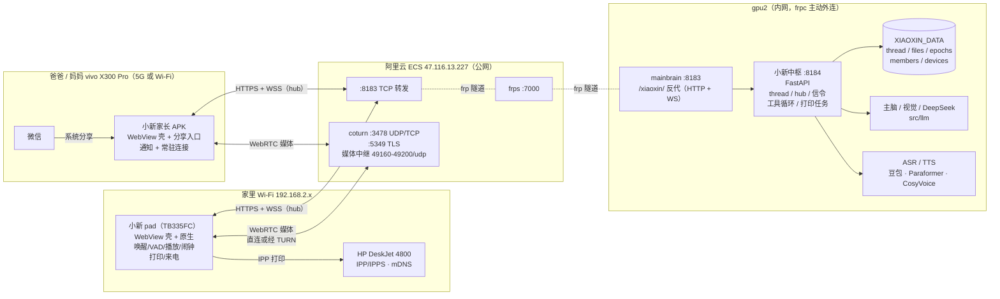
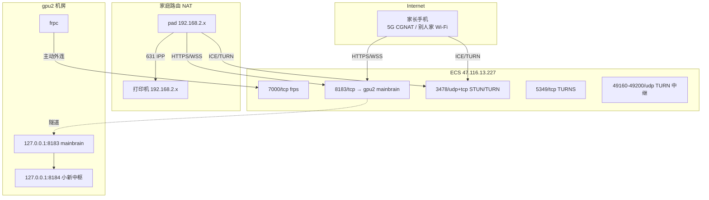
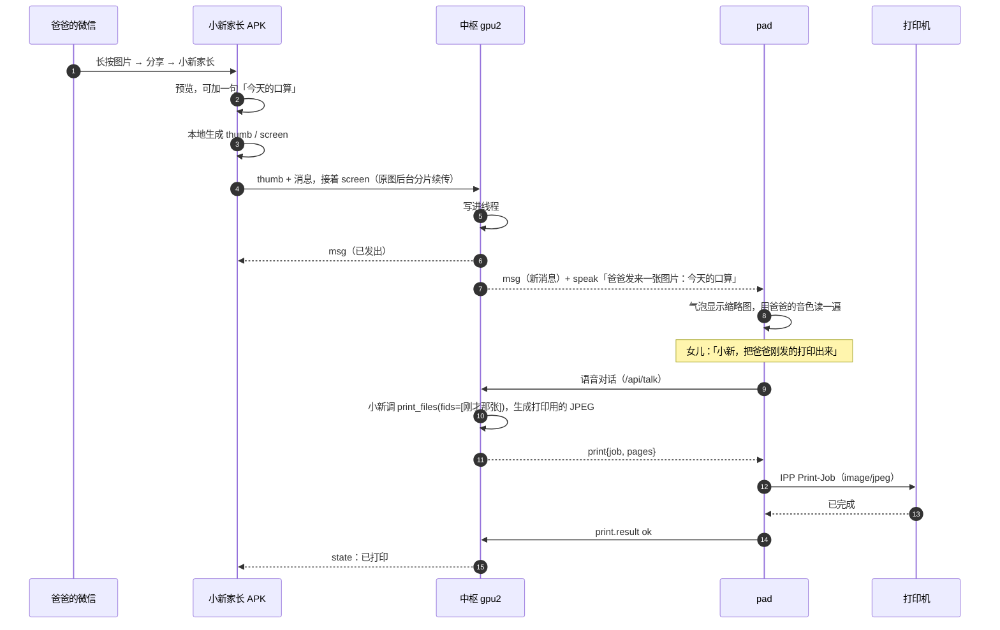
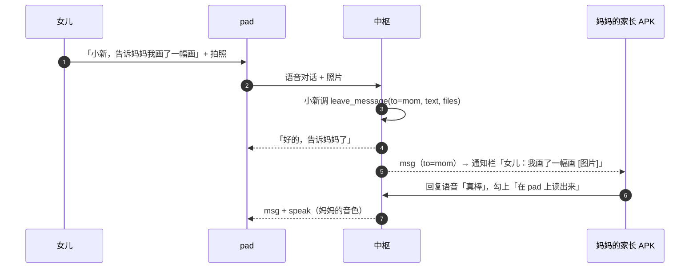
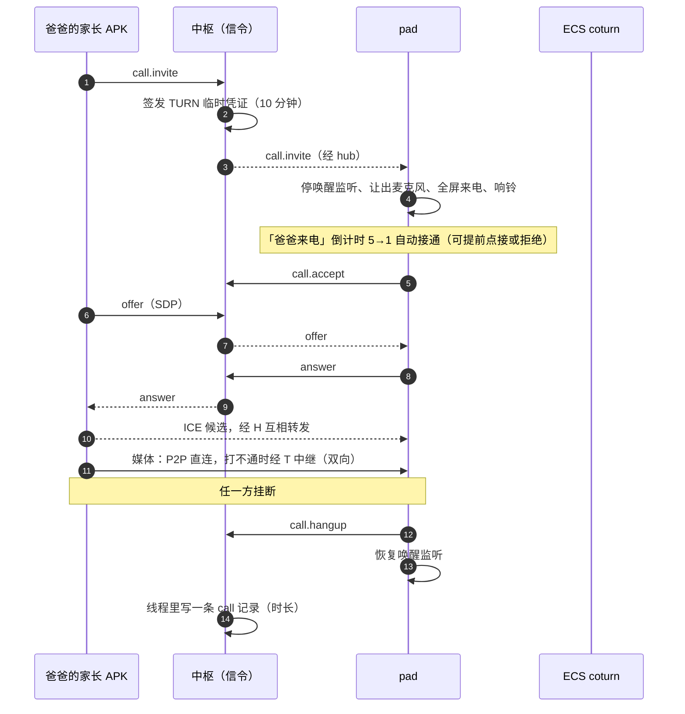

# 小新家庭版总架构

> 状态：设计稿（2026-10-31）。阶段 0、1 已完成；2026-10-31 晚改成「每个孩子一条线程」（见 6.0），阶段 1 的单线程按 6.1 迁过去。图用 Mermaid 画，GitHub 能直接看；在 VS Code 里看要装 Markdown Preview Mermaid Support。

## 1. 目标

小新是每个孩子的伙伴，不是一个能开很多窗口的聊天工具。儿子、女儿各有一台 pad、各有自己的小新，和爸爸妈妈组成一个「家庭小微信」：

| 要做到的 | 说明 |
|:--|:--|
| 每个孩子一个会话 | 儿子、女儿各自独立：自己的 pad、自己的聊天记录、小新对他的记忆、闹钟。pad 上永远只有一个「小新」，没有「新建对话」 |
| 家长分开聊 | 家长端像微信的聊天列表：「女儿」「儿子」两个会话，各自和那个孩子（以及他的小新）聊。兄妹之间互相看不到 |
| 换脑不换群 | 上下文太长或被污染时，在设置里「开始新篇章」：小新的记忆窗口重开，家里人看到的聊天记录不动 |
| 家长端 | 爸爸妈妈装「小新家长」APK（两人都是 vivo X300 Pro），收发文字、原图、文件、语音留言 |
| 从微信转材料 | 微信里长按图片或文件 → 分享 →「小新家长」，就进了家庭会话 |
| 文字读出来 | 家长发的文字在 pad 上用 TTS 读给小朋友听；本机 CosyVoice 可以每位家长一个音色，豆包暂时只能用小新的声音 |
| 小朋友留言 | 女儿在 pad 上给爸妈留言：语音、拍照、文字，或者直接说「小新，告诉爸爸……」 |
| 视频通话 | 家长从 App 打给 pad，女儿随时能接；pad 不需要主动打出去 |
| 打印 | 小朋友说「把爸爸刚发的打印出来」，pad 直接让家里的 HP DeskJet 4800 出纸 |
| 微信通道（以后） | 官方通道（ClawBot / iLink、企业微信客服）可用后，作为一个渠道接进同一个会话 |

不做的：小新主动给家长打视频；群外的人加小新；用非官方协议托管个人微信号（有封号风险）。

## 2. 结论：能做，约 2～3 周

现有的基础大多能直接用：FastAPI 中枢、WebView 壳加原生音频、文件上传、视觉模型、TTS/ASR、前台服务（ClockService）、麦克风让渡（WakeListener）、frp 隧道。新增的是四块：

1. **成员、线程和设备**：成员分家长、孩子两种角色；每个孩子一条线程（他的聊天记录 + 小新对他的上下文窗口）；每台设备单独发 token。
2. **实时总线 hub**：每台设备连一条 WebSocket，新消息、播报、打印指令、来电信令都走它。
3. **小新家长 APK**：和 pad 一样是 WebView 壳，加分享入口、通知、常驻连接。
4. **视频通话**：在 WebView 里跑 WebRTC，ECS 上部署 coturn 做中转。媒体流不经过 gpu2。

工作量见第 11 节。最没把握的是 pad 来电时的麦克风让渡，以及三台设备 WebView 里的 WebRTC 兼容性，都放在阶段 0 先验证（第 10 节）。

## 3. 名词

| 名词 | 含义 |
|:--|:--|
| 中枢 | gpu2 上的小新服务（FastAPI，127.0.0.1:8184），存全部数据、调模型 |
| 成员 member | 家里一个人，角色是 parent（爸爸、妈妈）或 kid（儿子、女儿） |
| 设备 device | 某个成员名下登录过的一台 pad / 手机 / 浏览器，各有自己的 token，可以单独吊销 |
| 孩子线程 thread | 每个孩子一条、只追加的消息流水：孩子、他的小新、爸爸妈妈在里面说的全部话 |
| 篇章 epoch | 小新在某条线程里的上下文窗口从哪一条开始算。「开始新篇章」只移动这个起点 |
| 渠道 channel | 消息从哪来：pad 语音、pad 打字、家长 App、浏览器、微信（以后） |

## 4. 总架构



几点设计取舍：

- **任何一端都不要求在局域网里**。pad 和家长 App 都是直接连公网的 8183，Wi‑Fi、5G、热点都行。只有打印需要 pad 和打印机连着同一个 Wi‑Fi。pad 不在家时，打印指令留在队列里，回家连上家里 Wi‑Fi 后再打，或者提示「现在不在家，打不了」。
- **所有数据只放 gpu2 一处**。ECS 只做转发（frps）和媒体中继（coturn），不存聊天记录，不跑业务代码。这样 ECS 被攻破也拿不到家庭数据，部署仍然只有 `deploy/gpu2.sh` 加一个很少改动的 `deploy/ecs.sh`。
- **视频不走 frp**。frp 隧道只能用 TCP，又要绕一圈经过 gpu2，延迟和带宽都不合适。WebRTC 先尝试 pad 和手机 P2P 直连，打不通再经 ECS 的 TURN 中继。gpu2 只转发 SDP/ICE 这些小信令。
- **打印在 pad 上执行**。gpu2 在机房，访问不到家里的局域网。中枢只往 pad 发一条「打印 fid」指令，由 pad 下载文件后用 IPP 发给打印机。
- **家长端也是 WebView 壳**。和 pad 用同一套前端，只是按设备角色显示不同界面。原生部分只做 WebView 干不了的：分享入口、通知、常驻连接、来电全屏、相机和麦克风权限。
- **沿用现有入口**。8183 的 `/xiaoxin/` 反代已经支持 WebSocket（[deploy/mainbrain_xiaoxin_proxy.py](../deploy/mainbrain_xiaoxin_proxy.py)），自签证书由 APK 做证书固定（见 [TalkActivity.java](../android/xiaoxin/src/com/xiaoxin/app/TalkActivity.java) 的 `pinnedSha256`），家长 APK 照抄这套。

## 5. 网络拓扑与端口



| 端口 | 位置 | 用途 | 现状 |
|:--|:--|:--|:--|
| 7000/tcp | ECS | frps，gpu2 的 frpc 主动连上来 | 已有 |
| 8183/tcp | ECS → gpu2 | 小新 HTTPS、WSS，自签证书，客户端做证书固定 | 已有 |
| 3478/udp+tcp | ECS | STUN/TURN | **新开** |
| 5349/tcp | ECS | TURN over TLS，给只放行 443/TCP 的网络兜底 | **新开**，可选 |
| 49160–49200/udp | ECS | TURN 中继端口段，一路通话占 1～2 个 | **新开**，安全组同步放行 |
| 631/tcp | 家里局域网 | IPP 打印，pad 访问打印机 | 打印机已广播 `_ipp._tcp` / `_ipps._tcp` |

TURN 用短期凭证（coturn 的 `use-auth-secret`）：中枢每次通话签发一个 10 分钟有效的用户名和密码，ECS 上不存静态账号，凭证泄露了也很快失效。

带宽估算：720p 视频大约 1～1.5 Mbps 一个方向。走中继时 ECS 上下行各占这么多。家长在 5G 下多半直连不了，基本都会走中继，所以要看 ECS 的带宽档位（见第 10 节）。

## 6. 数据模型

### 6.0 角色、成员和线程（2026-10-31 定）

```
成员 members.json                 线程 threads/<kid>.json（每个孩子一条）
  dad   parent  爸爸 ─┐
  mom   parent  妈妈 ─┼── 能进每一条孩子线程 ──┬─ 女儿的线程：女儿 + 她的小新 + 爸爸妈妈
  son   kid     儿子 ─┼─ 只能进自己的 ────────┘└ 儿子的线程：儿子 + 他的小新 + 爸爸妈妈
  dau   kid     女儿 ─┘
```

- **两种角色，策略不一样**：

| | kid（孩子端，pad 上的「小新」） | parent（家长端，「小新家长」/ 浏览器） |
|:--|:--|:--|
| 能进哪些线程 | 只有自己那一条 | 每个孩子的线程，像微信聊天列表里的两个会话 |
| 小新什么时候回话 | 叫醒说话、打字都回 | 只在点亮「问小新」时回；平时发的话是给孩子的 |
| 小新的说话方式 | 按这个孩子的年级、称呼、说话要求（每个孩子单独配） | 正常大人口吻 |
| 视频 | 只接听：倒计时自动接通、免打扰 | 发起呼叫，选打给哪个孩子 |
| 打印 | 超过 5 页语音确认 | 直接打 |
| 设置 | 很少几项，改不了成员和设备 | 我的声音、通知、默认发原图 |
| 专用功能 | 待命唤醒、自由对话、闹钟、学习卡片 | 微信分享入口、拍照/选图、语音留言 |

- **权限看成员的角色，不看装的哪个 App**：爸爸用电脑浏览器登录，照样是家长权限。
- **兄妹互相看不到**：儿子的 pad 拿不到女儿线程里的任何东西（消息、文件、原声、调试记录），服务端每个接口按「这台设备的成员能不能进这条线程」检查。
- **每个孩子独立的东西**：聊天记录、小新的上下文和摘要、篇章、闹钟和计时、自由对话的原声、调试记录。
- **全家共用的东西**：引擎和音色设置、家长的「我的声音」、打印机、成员和设备表。
- 现在只有女儿一台 pad：阶段 1 的那条线程就是女儿的。儿子的 pad 到了在管理台新建「儿子」、配对就行。

### 6.1 线程和篇章：家人看到的记录与小新的记忆分开

```
一个孩子的线程（只追加）
  m1  m2  m3 … m480 │ m481 … m900 │ m901 …
  ───── epoch 1 ────┼── epoch 2 ──┼─ epoch 3（当前）
                    ↑             ↑
                 自动压缩换窗      设置里「开始新篇章」
```

- **线程**：一个孩子的只追加消息流水，他的 pad 和爸爸妈妈看到的都是它。可以无限往上翻，懒加载。
- **篇章**：小新上下文窗口的起点，外加上一篇的摘要。两种情况会开新篇章：
  - 现有的异步压缩（compact.py）到阈值后自动换窗，摘要带到下一篇；
  - 设置里点「开始新篇章」，可以选带上一篇摘要，也可以选完全空白。
- 开新篇章不删也不隐藏任何消息，线程里只插一条细灰线「小新翻开了新的一页」。小朋友和家长不用关心这件事。
- 调试面板按篇章分页，trace 的 cid 改成 epoch_id。

迁移：阶段 1 已把老的多段对话并成一条（备份在 `backup/pre-thread-*.tgz`）。阶段 2 把这一条认作女儿的线程（settings.json 的 `thread` 换成 members.json 里女儿的 `thread`），闹钟 `clock.json` 挪到 `clock/<女儿>.json`。

### 6.2 消息

```jsonc
{
  "id": "m_01J…",            // 单调递增，可排序（ULID）
  "ts": 1761900000.123,
  "from": "dad",             // 成员 id（dad | mom | son | dau）| xiaoxin | system；消息属于哪个孩子由所在线程决定
  "channel": "parent_app",   // pad_voice | pad_text | parent_app | web | wechat
  "to": "kid",               // kid（发给这个孩子） | xiaoxin（家长「问小新」） | dad / mom（孩子留言给某个家长）
  "kind": "text",            // text | image | file | voice | card | call | note
  "text": "晚上 7 点前把口算做完",
  "files": [{"id": "f_…", "name": "IMG_2031.jpg", "mime": "image/jpeg", "size": 4123456,
             "w": 4096, "h": 3072, "thumb": "f_…_t"}],
  "speak": {"on_pad": true, "voice": "dad"},   // 到 pad 后要不要读出来、用谁的音色
  "reply_to": "m_…",
  "actions": [ … ],          // 小新回复里的工具调用和结果（沿用现有结构）
  "state": {"delivered": ["pad1"], "read": ["kid"], "printed": ["job_…"]}
}
```

- **原图**：保留原始文件，不压缩，单个上限从 50 MB 提到 200 MB。分三档传，先小后大，见 6.5。
- **语音留言**：存 opus 原件，同时转一份文字。pad 上显示成可以点的语音条。
- **视频通话**：只记一条 `kind: "call"`，包含谁打的、有没有接、时长。不录音也不录像。

### 6.3 小新什么时候回话

孩子线程里不是每条消息都要小新接话。规则写在 prompt 和路由里：

| 消息 | 小新 |
|:--|:--|
| 孩子在自己 pad 上叫醒说话、打字 | 照常回答（现有逻辑） |
| 家长在某个孩子的会话里点亮「问小新」（`to=xiaoxin`） | 回答，回复出现在那个孩子的线程里，孩子 pad 上也看得到 |
| 家长发给孩子的普通消息、图片、文件（`to=kid`） | **不回话**。图片和文件进这条线程的上下文，让小新知道有这份材料；`speak.on_pad=true` 时在孩子 pad 上读出来 |
| 女儿说「告诉爸爸……」 | 调 `leave_message(to=dad, text, files)`，写进女儿的线程、给爸爸提醒，回一句「好的，告诉爸爸了」 |

小新的上下文里能看到每条消息的发送人和渠道（`[爸爸·家长App]`），这样「把爸爸刚发的打印出来」才知道是哪一张。

### 6.4 成员、设备和鉴权

现在全家共用一个 `XIAOXIN_KEY`，改成每台设备单独一个 token：

```
members.json   id、角色（parent | kid）、名字、称呼（小新怎么叫）、头像、状态（active | disabled）
               kid 另有：thread（他的线程 id）、年级、说话要求（拼进这个孩子的 system prompt）
               parent 另有：voice_sample（「我的声音」）
devices.json   device_id、member、类型（pad | phone | web）、名字、token 的 sha256、创建 / 最近在线时间
```

- 注册和配对**统一在管理台**（6.7）：管理员新建成员 → 给他加一台设备 → 屏幕上出二维码（一次性配对码，5 分钟有效）→ 家长 App 或 pad 扫码后拿到这台设备的长期 token。不用在任何地方手敲 URL 或 key。
- 现有的 `?k=XIAOXIN_KEY` 链接保留，作为管理员入口，用来调试和找回。
- 权限：parent 能进每个孩子的线程、发消息、打视频、发打印；kid 只能进自己的线程，**不能**改成员和设备，也拿不到别的孩子的任何数据。管理员（`?k=` 登录的）是全部权限，外加成员和设备管理。
- 管理台能看到所有设备，可以单个踢下线（吊销 token）。

### 6.5 图片分档传输（省 ECS 带宽）

所有 HTTPS 流量都经 frp 绕行 ECS，上传和下载都要占 ECS 那 5 Mbps 的出方向（约 0.6 MB/s）。所以原则是：**发送端在本地压好小图先发，原图在后台慢慢传；接收端默认不下载原图。**

| 档 | 规格 | 大小（以 12MP 照片为例） | 谁生成 | 用途 |
|:--|:--|:--|:--|:--|
| thumb | 长边 480px，JPEG q70 | ~30 KB | 发送端本地 | 消息列表里的气泡 |
| screen | 长边 2048px，JPEG q82 | ~400 KB | 发送端本地 | 点开看大图、双指放大；喂给视觉模型 |
| original | 原文件，原样不动 | 3～10 MB | — | 「查看原图」、下载、转发、打印的源文件 |

**发不发原图由发送方决定，和微信一样。**发图预览页左下角有「☐ 原图」，旁边显示大小，比如「原图 4.1M」：

| | 不勾（默认） | 勾上「原图」 |
|:--|:--|:--|
| 上传 | 只传 thumb + screen（~0.4 MB） | 再加 original，后台续传 |
| 接收方 | 看到的就是 2048px 大图，没有「查看原图」按钮 | 大图下面有「查看原图（4.1M）」，点了才下载 |
| ECS 流量 | ~0.4 MB | 上传 4.1 MB 一次，之后每个点「查看原图」的人各下载一次 |

- 默认不勾，这一点和微信一样。家长 App 的设置里可以改成「默认发原图」。
- 以「文件」方式发出去的图片（在文件管理器里选，或在微信里以文件形式分享）一律按原样传，等于勾了原图。PDF、Office 这类文件也一样。
- pad 上拍的照片默认不发原图。2048px 对小朋友的作业照、画作已经够用。
- 没勾原图就发出去的，事后不能再要原图（微信也不行）。想要的话，请对方重新勾上原图再发一次。

**勾了原图时的发送流程：**

```
点发送
 ├─ 0.0s  本地生成 thumb 和 screen（约 0.3s）
 ├─ ~0.1s 传 thumb + 发消息 → 对方马上出现气泡
 ├─ ~1s   传 screen → 对方点开就是清晰大图
 └─ 后台  分片续传 original（每片 512 KB）
          · 断网、切 Wi‑Fi/5G 后从断点续传，App 被杀掉下次打开接着传
          · 限速 2 Mbps，不挤占消息和语音；通话期间暂停
          · 发送方气泡上显示「原图 63%」，传完变成 ✓
```

**接收方不用等原图**：缩略图一秒内到，点开就能看清。点「查看原图」时：
- 原图已经传到 gpu2：直接下载，显示进度条，下载完缓存在本机，之后不再重复下载；
- 发送方还没传完：显示「对方原图上传中 63%」，先看大图，传完会自动换成原图；
- 长按可以「保存到相册」：有原图就存原图，没有就存大图。

**打印**：有原图时，gpu2 读原图，生成 A4 200dpi 的打印版 JPEG（约 1 MB），pad 只下载这一份；没有原图时直接用 screen 打，2048px 打 A4 大约 250dpi，作业照完全够。

**其他文件**：PDF 和 Office 文档先在发送端读出页数，发一条占位消息；文件本体同样分片续传。中枢收齐后生成第一页预览图推给 pad。

**以后可选的两条路**（现在不做）：
- **局域网直传**：家长手机和 pad 都在家里 Wi‑Fi 时，原图用 WebRTC DataChannel 直接传给 pad，不经过 ECS。gpu2 的那份等空闲时再补。
- **对象存储**：原图走阿里云 OSS，手机直传 OSS（上传入方向免费），pad 从 OSS 下载（按流量计费，约 0.5 元/GB）。一家人一个月几 GB，也就几块钱，等于绕开了固定带宽。

### 6.6 谁能看到什么、管理端

每个孩子一条线程，都存在 gpu2 一处，每个端看到的是它有权进的那几条，通过 hub 实时同步，延迟在 1 秒内。

| 角色 | 能看到 | 不能 |
|:--|:--|:--|
| 孩子（自己的 pad） | 自己线程里的全部：和小新的对话、爸爸妈妈发来的、自己的留言 | 兄弟姐妹的线程、设备管理、调试面板、成员设置 |
| 家长（家长 App） | 每个孩子的线程，分成两个会话：孩子和小新的语音对话（转成的文字，可以回放录音）、留言、文件和图片、通话记录 | 调试面板（可以在设置里打开） |
| 管理端（web，用 `?k=` 管理员链接登录） | 家长能看的全部，外加：每台设备的在线状态和最近同步时间、消息的送达/已读/打印状态、按篇章分页的调试面板（每一轮的 system、上下文、工具调用）、篇章切换和压缩记录 | — |

- **`to` 只决定提醒谁**，不决定谁能看。女儿说「告诉妈妈……」，通知和「给你的留言」标记只发给妈妈，爸爸在女儿的会话里同样看得到。家长和孩子之间不做私聊，好处是孩子的所有对话都在两个家长眼里。
- **管理端实时看到 pad 上的对话**：pad 语音对话的每一轮（女儿说的话、小新的流式回复、卡片和工具调用）都写进线程，再经 hub 推给所有在线的端，不用刷新。
- **视频通话只记元数据**：谁打的、接没接、多长时间。不录音，不录像，也不转文字。
- 管理端就是现有的 web 界面加一个「管理」页，不另做后台系统。

**云端是唯一的真相，各端都是镜像。**

- 消息以 gpu2 写进线程那一刻为准。别人发给你的消息，即使你手机离线，云端、管理端和 pad 也都已经有了；手机下次连上，按 `since=<最后一条 id>` 把缺的补回来。
- 手机本地缓存最近的消息和缩略图（IndexedDB），离线时也能翻看，但只读。
- **反过来要注意**：离线时你发的消息还在手机的发件箱里，没到云端，别人看不到。气泡上显示「⏱ 等待发送」，联网后自动按顺序补发；补发成功才算发出，时间按到达云端的时间记。每条消息带客户端生成的 id，补发不会重复。
- 换手机或重装 App 不会丢数据：扫码配对后从云端重新拉，本地缓存清掉也不影响。

### 6.7 Web 管理台

不推倒重做。管理台和 pad、家长端共用同一套前端（线程渲染、卡片、调试面板都复用），只在外面加一层管理外壳，地址是 `/xiaoxin/admin`。登录还是用 `?k=` 管理员链接打开一次，浏览器记住一年。

```
┌───────────┬──────────────────────────────────────────────────────┐
│ 小新管理台 │  视角： [ 👨 爸爸 ▾ ]   👁 只读预览          🟢 pad 在线  │
│           ├──────────────────────────────────────────────────────┤
│ 💬 孩子线程 │                                                      │
│ 👥 成员设备 │      （和爸爸的家长 App 看到的完全一样：               │
│ 🔍 调试    │       未读、给他的留言高亮、他能看到的按钮）            │
│ ⚙️ 设置    │                                                      │
│ 📊 系统    │                                                      │
│           │  [ 以 管理员 身份发送…                       ] [发送] │
└───────────┴──────────────────────────────────────────────────────┘
```

**视角切换**：顶栏一个下拉框，选项是「管理视角 / 爸爸 / 妈妈 / 儿子 / 女儿」，切换是即时的，不改 URL、不用重新登录。左侧再选看哪个孩子的线程（选孩子视角时只有他自己那一条）。
- 选某个人，就渲染成他那一端的样子：他的未读数、给他的留言、他的角色能看到的按钮。用来排查「妈妈说她那边看不到」这类问题。
- **只读**：切到别人的视角时，不会替他标已读、不会替他发消息，也不会触发他手机上的任何东西。
- 管理员发出的消息署名是管理员本人（一般就是爸爸），不能冒充别人发。
- 「全家」视角额外显示每条消息的送达/已读/打印状态，以及每台设备的同步进度。

**成员和设备**（统一注册的地方）：页面分「家长」「孩子」两组列出来，每个人下面是他的设备。

| 操作 | 说明 |
|:--|:--|
| 新建成员 | 名字、称呼（小新怎么叫他）、角色 parent / kid、头像；孩子另填年级、说话要求，新建时自动给他建一条空线程 |
| 编辑成员 | 上面这些都能改；角色不能改（孩子的线程和闹钟跟着人走，改角色会乱） |
| 添加设备 | 选成员 → 选类型（家长手机 / pad / 浏览器）→ 出配对二维码，5 分钟有效。手机打开小新家长扫码；pad 在小新设置里扫码 |
| 设备列表 | 每台设备：型号、App 版本、在线状态、最近同步时间、离线发件箱里还积压几条 |
| 踢下线 | 吊销 token，那台设备立即退出，要重新扫码 |
| 声音 | 看每个人有没有录「我的声音」，可以试听；本人或管理员可以删 |
| 停用成员 | 默认的「删除」：吊销他所有设备，历史消息和孩子的线程保留，可以恢复 |
| 彻底删除 | 二次确认后才做：家长的消息署名改成「已删除的成员」；孩子的线程先打包备份再删 |

**其余页面**：调试（现有的调试面板，按篇章分页）、设置（现在设置面板里的引擎、音色、闹钟、上下文上限，加上视频通话的倒计时和免打扰）、系统（篇章和压缩记录、存储占用、今天的 ECS 流量、TURN 中继的使用情况）。

每条管理操作（建成员、发配对码、踢设备、开新篇章）都记进审计日志 `audit.jsonl`，在「系统」页可以看。

## 7. 实时总线 hub

每台设备登录后连一条 `WSS /xiaoxin/api/hub`，全部实时事件都走这一条，靠心跳保持。断了指数退避重连，带上 `since=<最后一条消息 id>` 把漏掉的补回来。

| 事件 | 方向 | 内容 |
|:--|:--|:--|
| `msg` | 中枢 → 全部 | 新消息（含小新流式回复的分片 `msg.delta`） |
| `state` | 中枢 → 全部 | 已送达、已读、已打印 |
| `speak` | 中枢 → pad | 读这条：mid、文字、音色。pad 用现有的 TTS 播放链路 |
| `print` | 中枢 → pad | 打印任务：job_id、若干页 JPEG 的 fid、份数、彩色还是黑白 |
| `print.result` | pad → 中枢 | 成功、缺纸、离线、出错 |
| `call.*` | 双向 | 视频信令：invite / ringing / accept / reject / offer / answer / ice / hangup |
| `presence` | 中枢 → 全部 | 谁在线、pad 是否待命中、是否正在通话 |

pad 现有的 `/api/talk` 和 `/api/asr/stream` 两个 WebSocket 不动，它们是音频流，不并进 hub。

## 8. 典型场景

### 8.1 爸爸在微信里收到老师的作业图，转给女儿并打印



### 8.2 女儿给妈妈留言



### 8.3 爸爸打视频给女儿



#### 来电和通话界面（pad）

**倒计时自动接通**是默认行为，只有家长能打进来。

```
┌──────────────────────────────────────────┐
│                                          │
│              ╭─────────╮                 │
│              │  爸爸头像 │  ← 外圈是倒计时圆环 │
│              ╰─────────╯                 │
│               爸爸来电                    │
│                                          │
│                 3                        │  ← 大号数字 5→1，每秒「嘀」一声
│          秒后自动接通                      │
│                                          │
│   ┌────────────┐      ┌────────────┐     │
│   │  现在接 📹  │      │  先不接 ✋  │     │  ← 两个大按钮，小朋友好按
│   └────────────┘      └────────────┘     │
└──────────────────────────────────────────┘
```

- **触发**：hub 收到 `call.invite` 后，pad 点亮屏幕（屏幕关着也会亮），全屏盖在任何界面上，包括待命、自由对话和闹钟面板。正在自由对话就先打断、让出麦克风，再用小新的声音说一句「爸爸打视频来啦」，然后开始 5→1 倒计时。
- **到 0 自动接通**，也可以提前点「现在接」。点「先不接」时，家长那边显示「女儿现在不方便」，线程里记一条未接来电。
- **接通后**：

```
┌──────────────────────────────────────────┐
│                               ┌───────┐  │
│                               │ 自己   │  │  ← 右上角小窗，可以拖动
│        爸爸的画面（全屏）        └───────┘  │
│                                          │
│                                          │
│   00:42                                  │
│        ( 🎤 静音 )   ( 🔴 挂断 )   ( 🔄 )  │  ← 底栏 3 秒没碰就淡出，点一下屏幕再出来
└──────────────────────────────────────────┘
```

  - 挂断按钮做得最大、最红。静音和切换前后摄像头放两边，小一点。
  - 通话中唤醒词不生效，小新不插话。挂断后回到原来的界面，恢复唤醒监听。
- **例外**：
  - 闹钟正在响：先把闹钟停掉，再进来电界面。
  - 已经在通话中：第二个家长打进来时，告诉他「正在和妈妈视频」，不打断当前通话。
  - **免打扰时段**（可配置，默认 21:30–7:00）：不倒计时，只响铃，等小朋友手动接。家长 App 发起呼叫前会提示「现在是女儿睡觉时间」。

#### 家长端

拨号界面显示「正在呼叫女儿… pad 5 秒后自动接通」，同步显示 pad 那边的倒计时。接通后的界面和 pad 一样：对方画面全屏，自己在小窗。

#### 配置

在 pad 设置的「视频通话」里：自动接通开关（默认开）、倒计时秒数（3～10，默认 5）、免打扰时段。

### 8.4 上下文被污染，开始新篇章

设置 → 小新的记忆 → 开始新篇章（可选「带上摘要」）→ 中枢新建 epoch，线程里插一条灰线。之后小新的上下文从这里开始，聊天记录照样能往上翻。

### 8.5 打印的格式转换

打印机广播的能力（2026-10-31 用 mDNS 查到的）：`pdl=image/jpeg, image/pwg-raster, image/urf, application/PCLm, application/vnd.hp-PCL`，彩色，**不支持双面**，纸张最大 A4，Mopria 2.0 认证。**不直接吃 PDF**，所以转换放在中枢上做：

| 原件 | 中枢转换 | 发给打印机 |
|:--|:--|:--|
| JPEG / PNG / HEIC 图片 | 转正方向、按 A4 等比缩放并留边，导出 300dpi JPEG | image/jpeg |
| PDF | `pdftoppm -r 300 -jpeg` 每页一张 | 多个 image/jpeg 任务，或拼成 PWG |
| Word / Excel / PPT | `libreoffice --headless --convert-to pdf`，再按 PDF 处理 | 同上 |
| 小新的卡片（笔顺、闹钟、图表） | pad 的 WebView 截图，或中枢用 matplotlib / 模板直接出图 | image/jpeg |

pad 端用原生代码写一个很小的 IPP 客户端（Print-Job 和 Get-Printer-Attributes 两个操作），静默出纸，不弹系统打印框。打印机的地址用 mDNS 发现后缓存起来。小朋友发起的打印，一次超过 5 页要先语音确认；家长发起的不用。

## 9. 代码仓库分配

还是**一个仓库** ai_xiaoxin，不拆。新增和调整的部分：

```
ai_xiaoxin/
├── server/                     中枢（gpu2，deploy/gpu2.sh）
│   ├── main.py                 只留 app 装配和现有路由；新路由拆到下面的模块
│   ├── family/                 【新】家庭版
│   │   ├── members.py          成员、设备、token、配对码
│   │   ├── thread.py           线程（只追加、分页、送达和已读状态）、epoch 切换
│   │   ├── hub.py              /api/hub WebSocket：连接表、广播、补发、presence
│   │   ├── call.py             视频信令转发、TURN 临时凭证签发
│   │   ├── printing.py         打印任务：格式转换（pdftoppm / libreoffice / PIL）、下发、回执
│   │   └── routes.py           /api/thread、/api/members、/api/devices、/api/print
│   ├── tools/
│   │   ├── message.py          【新】leave_message（留言给某人）
│   │   └── printer.py          【新】print_files、printer_status
│   ├── prompts/family.md       【新】家庭成员、渠道、什么时候回话
│   ├── store.py                原图上限调整、缩略图、迁移脚本
│   └── static/
│       ├── app.js / app.css    改成线程界面；按 role=pad|parent 显示不同界面
│       ├── thread.js           【新】线程渲染、懒加载、消息状态
│       ├── call.js             【新】WebRTC（getUserMedia、RTCPeerConnection、来电和通话界面）
│       ├── share.js            【新】家长 App 的分享预览页
│       └── admin.js / admin.css【新】管理台外壳：视角切换、成员设备、系统页
├── android/
│   ├── build.sh                新增目标 parent
│   ├── xiaoxin/                pad 端：加 Printer.java（IPP）、CallActivity、hub 常驻连接
│   ├── parent/                 【新】小新家长 com.xiaoxin.parent
│   │   ├── AndroidManifest.xml SEND / SEND_MULTIPLE 的 intent-filter、前台服务、通知、相机和麦克风权限
│   │   └── src/com/xiaoxin/parent/
│   │       ├── MainActivity.java   WebView 壳（证书固定、JS bridge）
│   │       ├── ShareActivity.java  接收微信分享 → 上传 → 打开预览
│   │       ├── HubService.java     前台服务保活 + 通知（留言、来电）
│   │       └── Pairing.java        扫码配对，token 存进 EncryptedSharedPreferences
│   └── testapp/
├── util/com/xiaoxin/util/      两个 App 共用：WebSocket、Cues；【新】Shell（WebView、证书固定、bridge 公共部分）、Hub 客户端
├── deploy/
│   ├── gpu2.sh                 不变
│   ├── ecs.sh                  【新】装或更新 coturn、开安全组提示、写 turnserver.conf（secret 来自 .env）
│   └── ecs/turnserver.conf     【新】模板，不含密钥
├── tests/                      family/*、打印转换、信令状态机、迁移脚本，都有单元测试
└── docs/
    ├── architecture.md         本文
    └── family/                 【新】各阶段的详细设计和验收记录
```

几条约定：

- 中枢只有一个进程，hub、信令、打印任务都在里面，不额外起服务。
- 两个 APK 用同一个签名（`android/debug.keystore`），按包名区分。公共代码放 `util/`，不复制粘贴。
- 前端一套，按 `/api/me` 返回的 role 渲染。pad 和家长 App 加载的是同一个 URL。
- 密钥（TURN secret、设备 token 的盐）只放 `.env`，ECS 上的那份由 `deploy/ecs.sh` 写入，权限 600。

## 10. 风险和待验证

| # | 风险 | 影响 | 怎么验证 / 兜底 |
|:--|:--|:--|:--|
| 1 | vivo 后台杀进程，家长 App 收不到留言通知 | 留言要等打开 App 才看到 | **已定：可以接受**，和微信被杀后台一样，打开时按 `since` 补齐。不接厂商推送；App 在前台和最近任务里时照常实时收 |
| 2 | ECS 带宽 5 Mbps | 走中继时视频卡 | 中继时 ECS 出方向要承担两个方向的流量。码率上限设为每方向 1.2 Mbps（720p@24fps），一路通话约占 2.4 Mbps，留出 HTTPS 余量；WebRTC 检测到拥塞会自动降到 480p。同一时间只允许一路通话。**更紧的是原图和文件**：所有 HTTPS 流量都经 frp 绕行 ECS，上传和下载都占 ECS 的出方向（上传是 ECS→gpu2，下载是 ECS→手机/pad），4 MB 原图单程约 7 秒。对策是分档传输（6.5）：先发 30 KB 缩略图和 400 KB 大图；原图只有发送方勾了「原图」才传，而且后台限速续传，接收方点了才下载；通话期间暂停原图传输。实例是 t6 突发型（2 核 1 GiB），coturn 中继一路占用的 CPU 很少，不是瓶颈 |
| 3 | pad 来电时麦克风冲突 | 唤醒监听和 WebRTC 抢麦 | **2026-10-31 实测**：TB335FC 上待命监听和 WebRTC 同时录音，系统两路都是 not silenced，对方能听到声音。不会抢麦，但通话中说「小新同学」会误唤醒，所以阶段 6 照旧来电时停唤醒、挂断后恢复 |
| 4 | 打印格式 | 有些文档转出来排版不对 | 先只保证图片和 PDF；Office 文档交给 libreoffice，跑一批真实作业文档验收 |
| 5 | 数据迁移 | 旧对话丢失 | 迁移前整体备份到 `private_data/xiaoxin/backup/`，迁移脚本可以重复跑，先在副本上演练 |
| 6 | 公网暴露面变大 | 设备 token 被盗 | token 按设备签发、可吊销，只存哈希；配对码一次性；TURN 用短期凭证 |
| 7 | WebView 里的 WebRTC 兼容性 | 两台 vivo、联想 pad 系统 WebView 版本不同 | **2026-10-31 实测**：Mac 无头 Chrome ↔ pad 上小新 / 小新家长（WebView 140），局域网直连和强制 ECS 中继都通（中继 RTT 40～50 ms，640x360）。vivo X300 Pro（WebView 138）还没测，要手机 |

## 11. 分阶段和工作量

| 阶段 | 内容 | 验收 | 估计 |
|:--|:--|:--|:--|
| 0 | 本文定稿；ECS 开端口、装 coturn；三台设备 WebRTC 最小 demo（风险 3、7） | demo 互打通。**除 vivo 手机外已完成**（tests/e2e/call.py） | 1 天 |
| 1 | 唯一线程 + epoch + 迁移；去掉侧栏多会话；设置里「开始新篇章」 | 旧数据全部能看，小新上下文正确 | 2 天 |
| 2 | 成员（家长 / 孩子）、每个孩子一条线程（女儿的迁过来、闹钟按孩子分）、设备 token、按线程鉴权；hub；消息带身份；多端实时同步；图片分档、原图续传 | 儿子的设备拿不到女儿线程的任何接口；两个浏览器加 pad 三端实时一致 | 4 天 |
| 2b | 管理台：外壳、视角切换（只读）、成员设备页（注册、二维码配对、踢下线）、审计日志 | 管理台新建「妈妈」并配对，切到妈妈视角和她手机上看到的一致 | 2 天 |
| 3 | 小新家长 APK：壳、扫码配对、微信分享入口、打开时同步、在前台时通知 | 微信分享一张原图，pad 上 2 秒内出现并读出来 | 2 天 |
| 4 | 打印：pad 上的 IPP 客户端、中枢格式转换、print_files 工具 | 说一句话打出图片和 PDF | 2 天 |
| 5 | 留言：leave_message、`to` 路由、语音留言；家长设置「我的声音」（CosyVoice 复刻） | 女儿留言，妈妈打开 App 就看到；pad 用妈妈的声音读她的消息 | 2 天 |
| 6 | 视频：信令、TURN 凭证、码率上限；pad 全屏来电加倒计时自动接通、麦克风切换、免打扰；家长端通话界面 | 5G 下爸爸打给 pad，5 秒自动接通，通话 10 分钟稳定 | 3～4 天 |
| 7 | 微信官方通道（等 ClawBot / 企业微信客服能用） | — | 以后再说 |

合计约 **17～20 个工作日**。每个阶段单独可用、单独提交，做完一阶段在 pad 上实测、补单元测试，再进下一阶段。

## 12. 已定的决策（2026-10-31）

| 事项 | 结论 |
|:--|:--|
| 后台通知 | 不保活、不接推送；打开 App 时同步，和微信一样 |
| 账号模型 | 成员分家长 / 孩子两种角色，策略不同（6.0）；儿子、女儿各一台 pad、各自一条线程，历史、记忆、闹钟独立，兄妹互相看不到；家长分别和两个孩子聊；管理台统一增删改成员和设备 |
| ECS 带宽 | 5 Mbps：720p 每方向码率上限 1.2 Mbps，同时只允许一路通话 |
| 来电 | 「爸爸来电」全屏 + 5→1 倒计时自动接通，见 8.3 |
| 家长音色 | 每个家长账号在设置里「录我的声音」，见下文 |

### 家长音色

- **入口**：小新家长 App → 设置 → 我的声音 → 录一段 6～10 秒（照着屏幕读一段话），试听满意后保存。复用现有的录音和截取流程（`store.save_sample` / `pick_reference`），样本挂到这个成员名下（`members.json` 的 `voice_sample`）。
- **播放**：pad 读这位家长的消息时，`speak.voice` 用这位家长的样本。
  - TTS 引擎是 CosyVoice：用家长的声音复刻。
  - 引擎是豆包，或这位家长还没录：退回小新的声音，消息气泡上标一个小字「小新代读」。
- 小新自己说话一直用小新的声音，不受家长音色影响。
- 家长可以随时重录或删除，删除后立即退回小新的声音。

