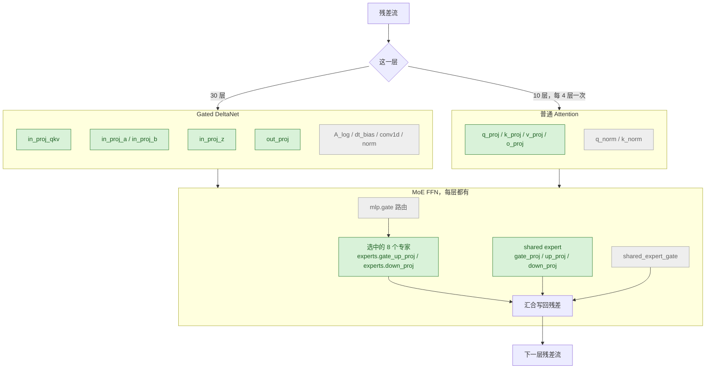

# Qwen3.6-35B-A3B：LoRA 挂在哪

绿色是挂 LoRA 的，灰色是冻住的。40 层语言层里，30 层是 Gated DeltaNet，10 层是普通 attention，每 4 层一次。每层后面都是同一块 MoE FFN：256 个专家，每个 token 选 8 个，外加一个始终在走的 shared expert。

只训语言部分。视觉塔、MTP 头、embedding、`lm_head` 都冻住，图里不画。原理和完整训练方案见 [qwen36-35b-a3b.md](qwen36-35b-a3b.md) §4。

BF16 版里路由专家是两个 3D 参数，要用 peft 的 `target_parameters` 挂，配置见 [qwen36-35b-a3b.md](qwen36-35b-a3b.md) §4.2。不要用 `all-linear`：它挂不到专家，却会挂到 `shared_expert_gate`、`lm_head` 和视觉塔。
